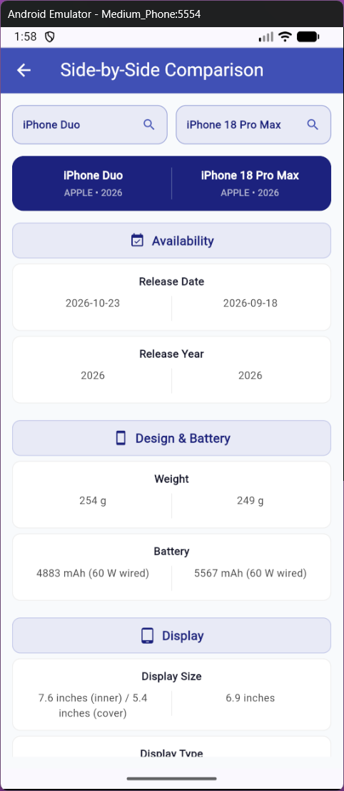
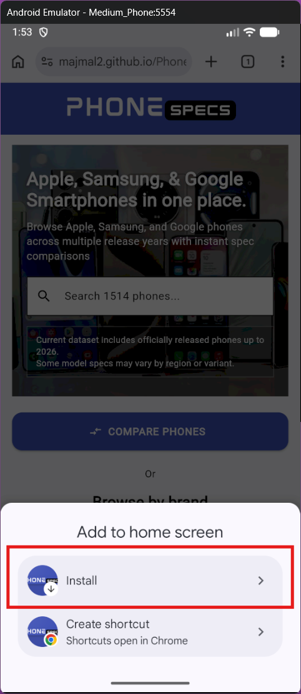

# PhoneSpecs 📱

A Flutter smartphone specification and side-by-side comparison application covering **Apple**, **Google**, and **Samsung** devices from **2007 to 2026**. Created by **Mahnoor Ajmal** for **IT 315: Mobile Development**.

## 🌐 Live App Preview
Try the app directly in your browser—no emulator or app store download required:
👉 **[Launch PhoneSpecs](https://majmal2.github.io/PhoneSpecs/)**

---

## 📸 App Preview

| Home & Search | Phone Specifications | Side-by-Side Comparison |
| :---: | :---: | :---: |
|  |  |  |
| Search Apple, Google, and Samsung phones (2007–2026) | View key hardware specs without digging through review videos | Compare device specs side by side at a glance |

---

## 📲 Install on Your Device (No Browser Needed)
You can install **PhoneSpecs** directly to your home screen or desktop so it opens full-screen like a native app without revisiting the browser link every time.

### Android (Chrome) — Step-by-Step

| 1. Open Chrome Menu (`⋮`) | 2. Tap Add to Home Screen | 3. Tap Install |
| :---: | :---: | :---: |
|  |  |  |
| Open **[PhoneSpecs](https://majmal2.github.io/PhoneSpecs/)** in Chrome and tap `⋮` in the top right | Select **Add to Home screen** (or **Install app**) | Tap **Install** to add the app to your home screen |

### iPhone / iPad (Safari)
1. Open **[https://majmal2.github.io/PhoneSpecs/](https://majmal2.github.io/PhoneSpecs/)** in **Safari**.
2. Tap the **Share** button (the square with an upward arrow at the bottom of the screen).
3. Scroll down, tap **Add to Home Screen**, and tap **Add**.

### Windows / Mac (Chrome or Edge)
1. Open **[https://majmal2.github.io/PhoneSpecs/](https://majmal2.github.io/PhoneSpecs/)** in **Google Chrome** or **Microsoft Edge**.
2. Click the **Install** icon on the right side of the address bar (or open the browser menu `⋮` → **Install PhoneSpecs**).
3. Click **Install** to launch it as a standalone desktop app.

---

## ✨ Key Features
* **Category & Search Bar Lookup:** Search smartphones across **Apple**, **Google**, and **Samsung** from **2007 through 2026**.
* **Detailed Specification View:** Quickly inspect hardware specs right at your fingertips without watching dozens of review videos.
* **Side-by-Side Comparison:** Compare specs across phones in one clean view.

## 🛠️ Built With
* **Framework:** Flutter
* **Language:** Dart
* **Data Source:** [TechAPI on GitHub](https://github.com/techspecs-io) / external JSON device database
* **Hosting & CI/CD:** GitHub Pages & GitHub Actions

## ℹ️ Data Note
PhoneSpecs pulls device data from an external JSON database powered by [TechAPI](https://github.com/techspecs-io). Because external datasets vary across older and newer models, certain granular specifications may be unavailable or omitted for specific devices.

---

## 👩‍💻 Author & Feedback
Created by **Mahnoor Ajmal** for **IT 315 (Mobile Development)**.  
Have feedback, suggestions, or spot a bug? Reach out at **[mahnoorajmalm22@gmail.com](mailto:mahnoorajmalm22@gmail.com)**.
